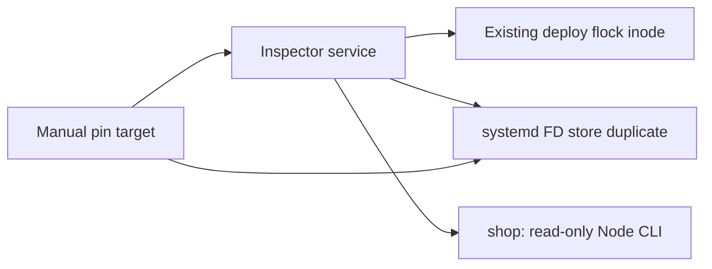

# Image runner: Linux sandbox — этап 5Б-2А

Дата: 2026-10-15. Основа — `c00ccbc` в `feat/product-image-production-runner`.
Контракты [production plan](product-image-production-plan.md) и
[runner 5Б-1](product-image-production-runner.md) сохраняются.
**Production apply безусловно запрещён: SANDBOX_UNVERIFIED.** Этот этап добавляет
неустановленные templates, inspector и fixture tests. Он не выполняет provisioning,
запуск unit на VPS, production reads/writes, deploy или backfill.

## Реализованные файлы и границы

| Файл | Назначение |
| --- | --- |
| [shop-image-runner@.service](../../deploy/shop-image-runner@.service) | Ручной system-level Type=exec template, root supervisor в отдельном rootfs; единственный Node child сбрасывает UID/GID до shop. |
| [shop-image-runner-pin@.target](../../deploy/shop-image-runner-pin@.target) | Ручная ссылка, сохраняющая service/FD store после stop/failure. RefuseManualStop=yes; освобождение fence отдельно. |
| [launcher.py](../../deploy/image-runner/launcher.py) | Linux inspection, actual cgroup/mount/process/manager checks, strict request, deploy flock/FDSTORE, существующий CLI только с --dry-run. Нет apply/exec/root/limit override. |
| [test_policy.py](../../deploy/image-runner/test_policy.py) | Портируемые parser/guard/unknown-lock regressions; синтетические входы проверяют валидатор, не enforcement ОС. |
| [test_native.py](../../deploy/image-runner/test_native.py) | Настоящие Linux syscalls: RO/no-follow/fsync/no-clobber, EXDEV, flock/FD9/SCM_RIGHTS. |
| [test_systemd.py](../../deploy/image-runner/test_systemd.py), [payload.py](../../deploy/image-runner/payload.py) | Opt-in disposable VM tests SIGTERM/SIGKILL, hung tree, parent/child OOM, FDSTORE lifetime и отсутствие restart. |
| [Dockerfile.validation](../../deploy/image-runner/Dockerfile.validation) | Только инструменты тестирования; pinned Python/Debian base. Не production rootfs/artifact. |

`deploy.sh`, существующие API/web/cleanup units, ImageStorage, encoder, inventory/approval
schemas и unconditional production gate не менялись. Бизнес-логика, API registry,
flags, env, Prisma и БД не менялись. Новых credentials у runner нет.

## Ограничения unit и проверка фактического состояния

| Контроль | Запрошенное значение | Как проверяется / предел |
| --- | --- | --- |
| Whole-tree memory | MemoryHigh=512M, MemoryMax=768M, MemorySwapMax=0 | Чтение настоящих memory.high/max/swap.max собственной cgroup v2. High — reclaim/throttle threshold, не hard cap. |
| OOM | OOMPolicy=kill | Effective manager policy и memory.oom.group=1. Реальный group OOM остаётся NOT VERIFIED. |
| CPU/tasks | CPUQuota=50%, period 100ms, TasksMax=64 | cpu.max и pids.max; учитываются descendants/native threads. |
| Время | RuntimeMaxSec=600, startup 15s, stop grace 30s | Effective RuntimeMaxUSec/TimeoutStopUSec; RuntimeMax включает работающий Type=exec service. Stop grace идёт дополнительно. |
| Kill/restart | KillMode=control-group, SIGTERM → SIGKILL, Restart=no | Effective properties; native lifecycle tests требуют systemd. Нет Install/timer/watch/автоповтора. |
| Файлы/IO | NOFILE=256, CORE=0, IOWeight=10 | Это запрошенный профиль; effective enforcement и device-specific I/O caps на целевом стенде ещё нужны. |
| Temp | /tmp tmpfs ≤64 MiB, /run tmpfs ≤8 MiB | Mountinfo type/options/size. PrivateDevices; нет tmp на общем диске uploads. |
| Привилегии | NoNewPrivileges, seccomp, capability allowlist, Delegate=no | Чтение NoNewPrivs/CapEff/CapAmb/Seccomp, RO cgroup mount и effective manager properties. Child получает пустые supplementary groups и отдельный env allowlist. |

Launcher не принимает environment assertions за cgroup proof. Сверяются
`/proc/self/cgroup`, настоящие cgroup files, `/proc/self/mountinfo`, process status,
effective unit/target properties через root-only systemd private socket. Неизвестный
лимит/max, cgroup v1/root path, missing controller, иной ControlGroup, transient или
instance override, drop-ins, pending daemon-reload, writable cgroup — отказ.
`systemctl show --all` нужен также для проверки пустых свойств, например DropInPaths.

Нужен **systemd 257+**: PrivatePIDs создаёт PID namespace, где launcher должен быть
PID 1. Так закрывается `/proc/<API-pid>/root`, доступный иначе при общем UID shop.
Неизвестная/проигнорированная директива не даёт разрешения: PID/process/manager
проверки откажут. См. [systemd.exec v257](https://github.com/systemd/systemd/blob/v257/man/systemd.exec.xml).
Версия systemd настоящего VPS не проверялась; автоматическое обновление не предлагается.

После проверки request/sandbox launcher запускает только существующий read-only CLI
как UID 997 и реальный GID из passwd, без предположения GID=997. Timeout child — 45s,
последний предел всего дерева — systemd. SIGTERM запрещает дальнейший запуск child;
активный child получает group signal. При timeout supervisor не освобождает manager FD.
Обычный успешный inspection тоже заканчивается exit 78 / SANDBOX_UNVERIFIED.

Текст unit, offline verify и parser tests **не доказывают** actual containment.
Зависший uninterruptible I/O может пережить deadline: до populated=0 fence не освобождать.
Ожидаемое наследование и ограничения описаны в [kernel cgroup v2](https://docs.kernel.org/admin-guide/cgroup-v2.html).

## Общий deployment fence и lifetime



Существующий deploy открывает `/run/lock/korzinamarket-deploy.lock` как FD 9 с truncation,
затем берёт flock. Inspector использует **тот же inode**, открывая заранее существующий
root-owned single-link regular file O_RDONLY|O_NOFOLLOW, без create/truncate/chmod/unlink.
Отсутствующий, symlink/replaced/unsafe file или занятый flock — отказ. Права lock не меняются.
Truncation отдельным opener не снимает flock; native regression воспроизвёл именно FD9.
Семантика file-description locks — [util-linux flock](https://github.com/util-linux/util-linux/blob/master/sys-utils/flock.1.adoc).

Одного parent FD недостаточно: Node spawn может закрыть лишние descriptors. Поэтому
до запуска Node тот же fd передаётся systemd через SCM_RIGHTS: FDSTORE=1, FDPOLL=0,
FDNAME=deploy-fence. BARRIER и actual NFileDescriptorStore=1 подтверждают принятие.
FileDescriptorStorePreserve=yes и активный pin target удерживают reference после
завершения/гибели supervisor, независимо от наследования FD worker-процессами.
NotifyAccess=main; Node не получает notify/manager env, socket FD или root privileges.
См. [FD store lifecycle](https://systemd.io/FILE_DESCRIPTOR_STORE/).

**Автоматического release нет даже после успешного inspection.** Launcher не вызывает
LOCK_UN, FDSTOREREMOVE, clean, unlink или quarantine. Повторное получение LISTEN_FDS
означает FENCE_BUSY; принятия старого fence/automatic resume нет. Новый instance также
не пересекает занятый глобальный flock. Unknown image/run locks остаются BUSY; PID,
mtime, boot age и успешный прошлый journal ничего не разрешают.

После SIGKILL/OOM/stop возможен retained FD store. Освобождение — отдельный reviewed
operator recovery: exact unit/invocation/boot/cgroup, populated=0/отсутствие descendants,
совпадение lock inode/dev, scope и исключение остальных writers. Не останавливать pin,
не удалять/recreate deploy lock и не чистить FD store по таймеру. Доверенный root может
обойти advisory protocol; root maintenance входит в trust boundary. Реальный manager
lifetime, GC, daemon-reload/reexec, stop и D-state ещё требуют acceptance.

## Filesystem, originals, aliases и EXDEV

RootDirectory — отдельный минимальный **ещё не собранный** immutable rootfs с Python ≥3.12,
systemctl, Node 24, Sharp и pinned API-only runtime artifact. Не bind всего checkout или
host `/`, `/etc`, `/home`, Docker socket, system bus, DB sockets, api.env/web.env.
В rootfs только необходимые runtime libraries/account records и read-only code. Python
supervisor имеет только SETUID/SETGID/DAC_READ_SEARCH/KILL; Node после drop не имеет
root capabilities. Private manager socket проверяется как root-owned 0700 socket;
доступ UID shop к нему должен быть отдельно подтверждён в acceptance.

Один общий RW bind uploads → `/storage` сохраняет один mount для
`product-variants` и `.product-image-state/work`. `products` получает отдельный RO bind;
chat скрыт. Parent `/storage` обязан быть root-owned, без group/other write и ACL,
с закрытым списком siblings. Variants/state — shop и фактический GID, 0700. Проверка
originals ограничена 100000 flat managed filenames: symlinks, directories, hardlink
aliases (nlink != 1) и неизвестные имена отклоняются. Это консервативный admission,
а не разрешение исправлять legacy файлы/ACL/owners на production.

Mount policy требует RO original/input/rootfs, запрещает writable mounts того же
device за пределами общего `/storage`, RW descendants originals, foreign proc,
writable sysfs/cgroup и неожиданные writable FS. Вместе с PID/root namespace,
parent DAC и single-link originals это закрывает предусмотренные alias paths.
Полнота этой политики и effective namespace ещё **NOT VERIFIED** на точном unit.
Наличие чужого trusted root/UID shop writer снаружи namespace эта политика не устраняет.

**Совпадающий st_dev недостаточен.** Native Docker test на двух mounts одного volume
получил EXDEV при одинаковом device. Inspector требует совпадения фактических mount IDs
state/work и variants. Он не пишет probe-файлы: `nativeLinkInUnit=NOT VERIFIED` остаётся
отдельным blocker. Нужен реальный bounded link/fsync/EEXIST probe из exact unit namespace
на отдельно утверждённом scratch fixture. Copy/overwrite fallback не добавлен.

API пока сохраняет прежний широкий RW uploads и UID shop. Поэтому **исключительность
записи runner относительно API не обеспечена текущим production API unit**. Нужен
отдельный review API policy: RO variants/state, недоступный runner control/rootfs,
сохранение штатного RW originals/chat и проверка пересечений/aliases. Общий UID также
оставляет host API возможность обращаться к dumpable worker через host `/proc`/ptrace;
одного PrivatePIDs у runner для обратного направления недостаточно. Нужен отдельно
проверенный API PID/proc boundary либо иное reviewed решение. Это дополнительный blocker,
а не обещание, что один RO bind полностью изолирует процессы с общим UID. В этом этапе
действующий API unit не меняется. API не должен читать root-owned control parent 0700;
inventory/approval передаются runner отдельными RO file binds. Runner не получает API,
DB, Telegram/admin credentials; unexpected supervisor env отклоняется целиком.

## Request и approved scope

Unit instance — lowercase UUID v4. Под host root-only control parent заранее готовятся
request.json, inventory.jsonl и approval.json, каждый regular/single-link, без symlink.
Фиксированные namespace paths — `/input/*`; CLI не принимает другие roots/executables.
Request ≤8 KiB, strict JSON без duplicate keys/NaN/Infinity, ровно поля:

```json
{"schemaVersion":1,"kind":"image-sandbox-inspection","runId":"550e8400-e29b-41d4-a716-446655440001","batchSize":1,"inventorySha256":"<64 lowercase hex>","approvalSha256":"<64 lowercase hex>","launcherSha256":"<64 lowercase hex>","unitSha256":"<64 lowercase hex>","pinSha256":"<64 lowercase hex>"}
```

Placeholder digest values намеренно невалидны. Проверяются actual bounded bytes/SHA-256,
inode/size/mtime stability, launcher и обе unit definitions. Нужны именно template
FragmentPaths, без instance overrides/drop-ins. Approval обязан назвать тот же instance
и batch 1/5/20/50. Existing Node verifier проверяет полный inventory/profile/artifact,
root identities, exact ordered entries, original SHA/fingerprints и READY/variants.
Нет apply, arbitrary argv, env-file, debug/force, limit override, scope expansion или
второго publisher. Packaging/native-binary hashes и подписанный provenance bundle пока
не готовы; Python request не подменяет existing approval и не открывает apply.

## Реальные результаты и команды только для fixtures

Windows: Python portable suite, профильные image unit/regression suites и root pnpm
typecheck/lint/build проверены отдельно. Linux проверялся в новом Docker container:
network=none, cap-drop=ALL, readonly root, private namespaces, memory=256 MiB, swap=0,
CPU=0.5, pids=64, bounded tmpfs. Mounts содержали только новые disposable fixture volume
и выбранные read-only исходники/tests; credentials/реальные фото/БД не подключались.

Фактические cgroup files Docker: memory.max=268435456, memory.high=max,
memory.swap.max=0, memory.oom.group=0, cpu.max=`50000 100000`, pids.max=64.
**Это не production systemd profile:** validator отверг бы этот набор. Чтение значений
также не является OOM/timeout acceptance. PID 1 — python; systemd 257.13 установлен
только как validation tooling, не как работающий manager.

Native tests проверили O_EXCL/O_NOFOLLOW, 0600, file и directory fsync/readback,
hard link/EEXIST/inodes, RO write/truncate/unlink/rename/chmod/link refusal, неизменность
fixture originals, cross-mount EXDEV, read-only flock, deploy-style FD9 и kernel FD
duplication через SCM_RIGHTS после SIGKILL owner при живом отдельном worker.
Последнее — native syscall proof, **не mock и не доказательство systemd FDSTORE**.
Unknown regular/run/symlink locks сохраняются без mutation.

Offline systemd-analyze verify на 257.13 прошёл на копиях templates с mode 0644
в новом container temp: без запуска units. Windows bind mounts отображали mode 0777,
поэтому исходники не chmod: правильные mode применялись только новым Linux-копиям.
Полные локальные отчёты — ignored `work/image-sandbox-linux.json`,
`work/image-sandbox-environment.json`, `work/image-sandbox-api-regressions.json`.

| Финальная проверка | Результат |
| --- | --- |
| Windows Python | 29 passed, 16 skipped (9 Linux native + 7 systemd), 0 failed, 45 cases. |
| Linux Docker Python | 38 passed: 29 portable + 9 native; 7 systemd NOT VERIFIED/skipped, 0 failed, 45 cases. |
| Existing image generator/manifest/storage/test-CLI/runner suites на Windows | 256 passed, 13 Linux-only skipped, 0 failed, 269 cases; statfs mocks прежнего runner suite не выдаются за native Linux acceptance. |
| Root pnpm typecheck/lint/build | API, web и telegram-gateway прошли. |
| Python Ruff 0.14.0 check/format | Passed, только новые Python files. |
| Offline systemd 257.13 verify | Exit 0, без warnings после копирования в fixture files 0644; execution не проверялось. |
| UTF-8/Markdown links/git diff --check | Проверены перед локальным коммитом. |

Портируемая проверка из корня checkout, без production:

```powershell
python -B -m unittest discover -s deploy/image-runner -p 'test_*.py' -v
```

Эквивалент native Docker fixture-проверки из изолированного Linux checkout, только
через локальный daemon и новый пустой volume (это не systemd acceptance):

```bash
fixture_repo=$(pwd)
fixture_client=$(mktemp -d /tmp/korzina-image-docker-client.XXXXXX)
fixture_volume="korzina-image-sandbox-fixture-$(cat /proc/sys/kernel/random/uuid)"
fixture_docker() { docker --host unix:///var/run/docker.sock --config "$fixture_client" "$@"; }
fixture_docker build -f deploy/image-runner/Dockerfile.validation -t korzina-image-sandbox-validation:5b2a deploy/image-runner
fixture_docker volume create --label korzina.fixture=5b2a "$fixture_volume"
fixture_docker run --rm --network none --read-only --cap-drop ALL --security-opt no-new-privileges \
  --memory 256m --memory-swap 256m --cpus 0.5 --pids-limit 64 \
  --tmpfs /tmp:rw,nosuid,nodev,noexec,size=128m,mode=1777 \
  --mount "type=volume,source=$fixture_volume,target=/fixture-mounts/one" \
  --mount "type=volume,source=$fixture_volume,target=/fixture-mounts/two" \
  --mount "type=volume,source=$fixture_volume,target=/fixture-mounts/readonly,readonly" \
  --mount "type=bind,source=$fixture_repo/deploy/image-runner,target=/fixture-repo/deploy/image-runner,readonly" \
  --mount "type=bind,source=$fixture_repo/deploy/shop-image-runner@.service,target=/fixture-repo/deploy/shop-image-runner@.service,readonly" \
  --mount "type=bind,source=$fixture_repo/deploy/shop-image-runner-pin@.target,target=/fixture-repo/deploy/shop-image-runner-pin@.target,readonly" \
  --mount "type=bind,source=$fixture_repo/apps/api/data/product-image-production/environment.ts,target=/fixture-repo/apps/api/data/product-image-production/environment.ts,readonly" \
  korzina-image-sandbox-validation:5b2a
```

Volume удалять только после подтверждённого выхода этого `--rm` контейнера, по точному
новому имени; не применять volume/container prune. Никаких mounts всей репозитории,
home, credentials, host cgroup или production directories. Локальный Windows orchestration
и raw observations сохранены в ignored `work/image-sandbox-linux.mjs` и
`work/image-sandbox-inspect.mjs`; в них те же выбранные source mounts и новые volumes.

Linux systemd suite запускается **только отдельно согласованно в disposable VM**,
с opt-in `KORZINA_DISPOSABLE_SYSTEMD=1` и прямым `test_systemd.py`. Opt-in не является
attestation: требуются настоящий PID1=systemd, root, версия ≥257 и actual cgroup files.
При недоступности прямой entrypoint выдаёт exit 78 / NOT VERIFIED. Общая discovery
честно показывает семь skips. Тест создаёт только новые unit names/data с prefix
`korzina-image-sandbox-fixture-*`; child/grandchild/setsid игнорируют SIGTERM,
memory hog запускается в parent/child. Проверяются kernel limits, timeout/OOM,
populated=0, NRestarts=0, retained manager FD и запрет остановки pin. Cleanup разрешён
только для известной fixture identity после quiescence; иначе всё сохраняется для
teardown VM. Production template/rootfs этим lifecycle suite полностью не принимается.

## Обязательные blockers и следующий Linux acceptance

| Blocker | Что требуется отдельно, до разрешения apply |
| --- | --- |
| Exact systemd sandbox | Disposable VM с systemd 257+, real cgroup v2/controllers; семь lifecycle tests без skips, точные child UID/capabilities/env/namespaces. Проверить PID reuse-safe signalling, hung/setsid children, memory events и отсутствие restart. |
| Fence lifetime | Настоящий FDSTORE/BARRIER, pin/GC/reload/reexec, SIGTERM/SIGKILL/OOM/stop, живые descendants/D-state; host deploy-lock inode совпадает с bound file и не пересоздаётся. Существующий deploy body не запускать. |
| Rootfs/artifact | Review и сборка минимального immutable API-only rootfs, actual Node/Sharp/native-library hashes, root-owned control, passwd/GID; ноль app/env/secrets. Не копировать рабочий checkout целиком. |
| Exact mounts/link | Только fixture roots в копии template на VM; RO originals/inventory и отсутствие writable/proc aliases, все denied mutation syscalls; actual state/work→variants link/fsync/no-clobber внутри namespace, negative EXDEV без fallback. |
| API и остальные writers | Отдельный reviewed API RO/control и PID/proc policy, effective mounts и защита от same-UID host ptrace/proc доступа; quiescence admin uploads/прочих publishers, approved source SHA baseline. Текущий API всё ещё может писать снаружи sandbox. |
| Recovery и budgets | Crash-point/READY/journal/checkpoint tests, boot/start/cgroup lock provenance, отдельный quarantine protocol без automatic unlock; реальные disk/inode/quota/retained/I/O/VPS headroom budgets. |
| Остальные production gates | G2–G9 исходного плана: approved no-DB deploy/rollback, внешний backup/restore, inventory, permissions, Nginx/cache/API latency/flags, explicit scope/операционные approvals. По ext4 nobarrier нужен G7 storage decision; power-loss durability не подтверждена. |

Никакие skips или зелёные parser tests не закрывают эти строки. До фактического
подтверждения всей цепочки и отдельного review production gate остаётся прежним.
Provisioning production, следующий этап, push/merge/deploy/backfill не выполняются.
